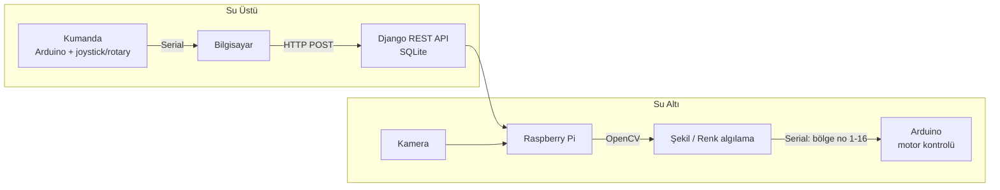

# Çaka ROV 🌊

**TEKNOFEST 2024 – İnsansız Su Altı Sistemleri Yarışması (Temel Kategori)** için geliştirdiğimiz ROV'un yazılım tarafı.

Bu repo, aracın su üstü ile su altı arasındaki haberleşmesini (Django + REST API), kamera üzerinden **şekil algılama** ve **renk tabanlı otonom görev** kodlarını içerir.

> 📦 **Proje durumu: Arşivlenmiştir (Archived).** Bu proje 2024 TEKNOFEST yarışma sezonunda geliştirilmiş olup artık aktif olarak sürdürülmemektedir. Kodda hatalar (bug) bulunabilir. Ayrıntılar için [Proje Durumu ve Sorumluluk Reddi](#proje-durumu-ve-sorumluluk-reddi) bölümüne bakınız.

| | |
|---|---|
| **Takım** | Çaka ROV |
| **Yarışma** | TEKNOFEST 2024 – İnsansız Su Altı Sistemleri, Temel Kategori |
| **Raporlar** | Kritik Tasarım Raporu (KTR) → [`docs/KTR_Raporu.pdf`](docs/KTR_Raporu.pdf) |
| **Benim rolüm** |Takım Kaptanı|
| **Sonuç** | Test Videoları Aşamasında (Yarı Final) Elenme |

---

## İçindekiler

- [Proje durumu ve sorumluluk reddi](#proje-durumu-ve-sorumluluk-reddi)
- [Projeye genel bakış](#projeye-genel-bakış)
- [Sistem mimarisi](#sistem-mimarisi)
- [Repo yapısı](#repo-yapısı)
- [Modüller](#modüller)
  - [1. Communication (Django + REST API)](#1-communication-django--rest-api)
  - [2. Şekil algılama (2. görev)](#2-şekil-algılama-2-görev)
  - [3. Renk tabanlı otonom görev (3. görev)](#3-renk-tabanlı-otonom-görev-3-görev)
- [Kurulum ve çalıştırma](#kurulum-ve-çalıştırma)
- [Tasarım kararları](#tasarım-kararları)
- [Bilinen sınırlamalar](#bilinen-sınırlamalar)
- [Araç hakkında](#araç-hakkında)

---

## Proje durumu ve sorumluluk reddi

Bu depo, 2024 yılında TEKNOFEST İnsansız Su Altı Sistemleri Yarışması kapsamında geliştirilen çalışmanın **arşiv niteliğindeki** bir kopyasıdır. Aşağıdaki hususlar kullanıcıların bilgisine sunulur:

1. **Bakım durumu:** Proje artık aktif olarak geliştirilmemekte ve sürdürülmemektedir. Hata bildirimleri ve değişiklik talepleri için herhangi bir güncelleme garantisi verilmemektedir.
2. **Hatalar:** Kod tabanı bilinen ve henüz tespit edilmemiş hatalar (bug) içerebilir. Bilinen sınırlamaların bir kısmı [Bilinen sınırlamalar](#bilinen-sınırlamalar) bölümünde listelenmiştir.
3. **Yapısal eksiklikler:** Proje, geliştirildiği dönemdeki tecrübe düzeyi ve yarışma takvimindeki zaman kısıtları çerçevesinde hazırlanmıştır. Bu nedenle kod yapısı, mimari ve kod kalitesi açısından kusursuz değildir; modülerlik, test kapsamı, hata yönetimi ve güvenlik gibi alanlarda iyileştirmeye açık noktalar mevcuttur.
4. **Mevcut hâliyle sunulma:** Yazılım, herhangi bir garanti verilmeksizin "olduğu gibi" (*as is*) sunulmaktadır. Yazılımın belirli bir amaca uygunluğu, kesintisiz veya hatasız çalışacağı konusunda taahhütte bulunulmamaktadır.
5. **Kullanım sorumluluğu:** Kodun gerçek bir araçta veya donanımda kullanılmasından doğabilecek her türlü sorumluluk kullanıcıya aittir. Donanımla birlikte kullanılmadan önce kodun dikkatle incelenmesi ve test edilmesi önerilir.
6. **Arşivleme amacı:** Kod, geliştirme sürecini ve o dönemki yaklaşımı belgelemek amacıyla bilinçli olarak yeniden yazılmadan, orijinal hâline yakın biçimde muhafaza edilmektedir.

---

## Projeye genel bakış

Yarışmada araç üç görevi yerine getiriyordu. Yazılım tarafı şöyle bölündü:

| Görev | Ne yapıyor | Bu repodaki karşılığı |
|---|---|---|
| **1. Görev – Manuel** | Su üstündeki kumandadan (joystick, potansiyometre, rotary encoder) araç kontrolü | `Communication/` (veri akışı API'si) |
| **2. Görev – Şekil algılama** | Kameradaki şekli bulup tipini (üçgen, kare, dikdörtgen, beşgen) belirleme | `Missions/shape_detection/`, `Communication/api/shape_detection_mode.py` |
| **3. Görev – Otonom** | İstenen rengi görüp o yöne hareket ettirme | `Missions/color_detection/`, `Communication/api/autonomous_mode.py` |

Teknoloji yığını: **Python, OpenCV, NumPy, Pandas, Django, Django REST Framework, SQLite, PySerial**. Donanım tarafında Arduino (C/C++) ve Raspberry Pi kullanıldı.

## Sistem mimarisi



Kısaca: kumanda verisi seri port üzerinden okunup Django API'sine yazılıyor, kamera görüntüsü OpenCV ile işleniyor, otonom modda ise rengin ekrandaki konumu bir bölge numarasına çevrilip Arduino'ya seri port ile gönderiliyor.

> Donanım detayları (Raspberry Pi 5, Arduino Mega/Nano, 6 adet itici, sensörler vb.) için [KTR raporuna](docs/KTR_Raporu.pdf) bakabilirsiniz. Arduino (C/C++) kodları bu repoda yer almıyor.

## Repo yapısı

```
ROV/
├── Communication/              # Django projesi (haberleşme + canlı görüntü)
│   ├── Communication/          # Proje ayarları (settings, urls, wsgi/asgi)
│   ├── api/
│   │   ├── views.py            # REST uçları + kamera akışı view'ları
│   │   ├── models.py           # `data` modeli (name, value)
│   │   ├── serializer.py       # DRF serializer
│   │   ├── shape_detection_mode.py   # Şekil algılama (MJPEG akışı olarak)
│   │   ├── autonomous_mode.py        # Renk tabanlı otonom mod (MJPEG akışı olarak)
│   │   └── colors.csv          # ~860 renk adı ve RGB değeri
│   ├── api_test_code/          # API ve Arduino seri port test scriptleri
│   ├── templates/              # Basit HTML sayfaları (ana sayfa, kamera sayfaları)
│   ├── manage.py
│   └── requirements.txt
├── Missions/                   # Django'dan bağımsız, tek başına çalışan görev kodları
│   ├── shape_detection/only_opencv.py
│   └── color_detection/autonomous_with_only_opencv.py
└── docs/
    └── KTR_Raporu.pdf          # TEKNOFEST Kritik Tasarım Raporu
```

## Modüller

### 1. Communication (Django + REST API)

Su üstü istasyonu ile aracın veri alışverişi için yazılan Django projesi. Veriler **SQLite** üzerinde tutulur.

| Endpoint | Metot | Açıklama |
|---|---|---|
| `/` | GET | Ana sayfa (şekil algılama ve otonom mod sayfalarına bağlantılar) |
| `/post_request` | POST | JSON olarak `rotary` ve `joyistik` değerlerini alır; veritabanında `id=1` (rotary) ve `id=2` (joystick) kayıtlarını günceller, kayıt yoksa oluşturur |
| `/get_request` | GET | Kayıtlı rotary ve joystick değerlerini JSON olarak döner |
| `/camera-feed` | GET | Şekil algılama canlı görüntü sayfası |
| `/camera` | GET | Şekil algılama MJPEG akışı |
| `/autonomous-page` | GET | Otonom mod canlı görüntü sayfası |
| `/autonomus-stream` | GET | Otonom mod MJPEG akışı (`blue` görev rengiyle başlar) |

Örnek istek:

```bash
curl -X POST http://127.0.0.1:8000/post_request \
     -H "Content-Type: application/json" \
     -d '{"joyistik": 512, "rotary": 120}'

curl http://127.0.0.1:8000/get_request
```

`api_test_code/` altındaki scriptler bu akışı test etmek için kullanıldı:

- `post_test_code.py`: Sürekli artan sahte değerleri API'ye gönderir.
- `get_test_code.py`: API'den sürekli değer okur.
- `arduino_serial_test_code.py`: Arduino'dan seri porttan okuduğu joystick değerini API'ye gönderir.

Kamera görüntüsü, `multipart/x-mixed-replace` ile **MJPEG akışı** olarak `StreamingHttpResponse` üzerinden tarayıcıya verilir (`` ile gösterilir).

### 2. Şekil algılama (2. görev)

Görüntüdeki şeklin tipini bulur. İki sürümü var:

- `Missions/shape_detection/only_opencv.py`: Bağımsız çalışan sürüm. Eşik değerleri **OpenCV trackbar'ları** ile canlı ayarlanır.
- `Communication/api/shape_detection_mode.py`: Django'ya entegre sürüm. Parametreler sabit (Canny eşikleri 50 / 100, minimum alan 5000), çıktı tarayıcıya akıtılır.

Algoritma:

1. Kameradan görüntü al (640×480)
2. Gauss bulanıklaştırma → gri tonlama
3. Canny kenar tespiti → genişletme (dilate)
4. `findContours` ile konturları bul, minimum alanın altındakileri ele
5. `approxPolyDP` ile köşe sayısını bul:
   - 3 köşe → **Üçgen**
   - 4 köşe → en/boy oranı 0.95–1.05 arasındaysa **Kare**, değilse **Dikdörtgen**
   - 5 köşe → **Beşgen**
6. Dört aşamalı görüntüyü (orijinal, Canny, dilate, kontur) tek ekranda birleştirip göster

> Bağımsız sürümde 4 köşe için kare/dikdörtgen ayrımı yoktur ("Dörtgen" yazar). Bu ayrım Django sürümünde eklendi.

### 3. Renk tabanlı otonom görev (3. görev)

Aracın istenen rengi (kırmızı, yeşil veya mavi) bulup o yöne yönelmesini sağlar.

1. **Ekran ve renk veritabanı:** `screeninfo` ile ekran çözünürlüğü, `colors.csv`'den renk adları yüklenir
2. **HSV'ye dönüştürme:** Görüntü HSV uzayına çevrilir, her renk için aralık tanımlanır ve **maskelenir**
   - Yeşil `[40,40,40] – [80,255,255]`
   - Mavi `[80,100,100] – [140,255,255]`
   - Kırmızı, HSV'de hue çemberinin iki ucunda olduğu için iki aralık: `[0–10]` ve `[160–180]`
3. **Merkez noktası:** Ekran merkezindeki pikselin rengi okunur, `colors.csv` içinde **en yakın renk adı** (Manhattan mesafesi ile RGB karşılaştırması) bulunur
4. **16 bölgeli yönlendirme:** Ekran 4×4 = 16 eşit bölgeye ayrılır (1920×1080 için her bölge 480×270). İstenen rengin bulunduğu pikselin hangi bölgede olduğu hesaplanır ve **bölge numarası (1–16)** `pyserial` ile Arduino'ya gönderilir
5. **Arduino tarafı:** Gelen bölge numarasına göre motorları yönlendirir (bu kod repoda yok)

Bölge numaralandırması sütun sütun, yukarıdan aşağıya:

```
 1   5   9  13
 2   6  10  14
 3   7  11  15
 4   8  12  16
```

## Kurulum ve çalıştırma

> ⚠️ Kod, yarışma sırasındaki **Windows geliştirme ortamına** göre yazıldı. Çalıştırmadan önce aşağıdaki "Çalıştırmadan önce değiştirmeniz gerekenler" bölümüne bakın.

```bash
git clone https://github.com/MelihKacan/ROV.git
cd ROV/Communication

python -m venv venv
# Windows:  venv\Scripts\activate
# Linux/macOS:  source venv/bin/activate

pip install -r requirements.txt
python manage.py migrate
python manage.py runserver
```

Sunucu `http://127.0.0.1:8000/` adresinde açılır.

**Bağımsız görev kodlarını çalıştırma:**

```bash
# Şekil algılama (çıkmak için q)
python Missions/shape_detection/only_opencv.py

# Renk tabanlı otonom görev (çalışınca görev rengi sorulur: red / green / blue)
python Missions/color_detection/autonomous_with_only_opencv.py
```

### Çalıştırmadan önce değiştirmeniz gerekenler

| Ne | Nerede | Açıklama |
|---|---|---|
| Seri port | `autonomous_mode.py`, `autonomous_with_only_opencv.py`, `arduino_serial_test_code.py` | `COM3` sabit yazıldı. Linux'ta `/dev/ttyUSB0` / `/dev/ttyACM0` gibi |
| `colors.csv` yolu | aynı iki otonom dosya | Yol, geliştirme bilgisayarına göre (`C:\Files_Desktop\...`) sabit yazıldı. Kendi yolunuzla değiştirin |
| Arduino ve ekran | `autonomous_mode.py` | Bu dosya Django açılırken içe aktarıldığı için `runserver`'ın başlayabilmesi için seri porta bağlı bir Arduino ve bir monitör (`screeninfo`) gerekir |

## Tasarım kararları

**TensorFlow yerine OpenCV.** İlk planda görüntü işleme için TensorFlow (makine öğrenmesi) kullanmayı düşündük. Raspberry Pi üzerinde ağır bir işlem yükü oluşturacağını fark edince yazılımı yalnızca OpenCV kullanacak şekilde yeniden düzenledik. Doğruluktan ödün vermeden donanım gereksinimi düştü ve geçiş yaklaşık 2 günde tamamlandı (detaylar KTR raporunda, "Tecrübe" bölümünde).

**Django + REST API ile haberleşme.** Python'a ve Django'ya takım olarak hâkim olduğumuz için, su üstü/su altı veri akışını JSON ile REST API üzerinden kurduk. JSON her dilde kolay okunuyor, Arduino ve Python tarafı arasında esneklik sağlıyor.

**Kamerayı HTML ile akıtma.** Görüntü API üzerinden değil, MJPEG akışıyla doğrudan `` etiketine verilerek gecikme düşük tutuldu.

**RAL kodlarının HSV'ye çevrilmesi.** Yarışmada renkler RAL koduyla verildiği için KTR raporunda RAL → HSV dönüşümü ve su altındaki renk kırılmalarının önceden hesaba katılması planlandı. Bu repodaki sürümde renk aralıkları sabit HSV değerleriyle tanımlı.

## Bilinen sınırlamalar

Bu bir yarışma projesi olarak hızlı geliştirildiği için bazı kısımlar bugün farklı yazılırdı. Gelişimi göstermek amacıyla bilerek düzeltilmedi:

- **Tekrarlayan kod:** 16 bölgeli yönlendirme, üç renk için ayrı ayrı `if/elif` zincirleriyle yazıldı (~600 satır). Tek bir fonksiyon ve bölge hesabıyla yazılabilir (`bölge = sütun * 4 + satır + 1`).
- **Sabit çözünürlük:** Bölge sınırları 1920×1080'e göre elle yazıldı, farklı ekranlarda bölge numaraları kayar.
- **Merkez piksel kontrolü:** Merkezdeki rengin RGB değeri, HSV aralıklarıyla karşılaştırılıyor. Doğrusu HSV değerini kullanmaktır.
- **Kırmızı maske:** Kırmızı için iki aralık tanımlı ama sonuç görüntüsü yalnızca ikinci aralıktan (`mask_red2`) üretiliyor.
- **İlk piksel:** Renk bölgesi, bulunan *ilk* pikselden belirleniyor. Kontur merkezi ya da alan ağırlıklı konum daha kararlı olurdu.
- **Sabit yollar ve portlar:** Seri port ve dosya yolları kod içinde sabit.
- **Güvenlik:** `settings.py` içinde geliştirme ortamı için `SECRET_KEY` ve `DEBUG = True` bulunuyor. Gerçek bir yayında kullanılmamalı.
- **Sade arayüz:** Repodaki HTML şablonları basit. Sensör verilerini ve görüntüyü birlikte gösteren daha gelişmiş arayüz KTR raporunda (s. 22–23) ekran görüntüsüyle yer alıyor.

## Araç hakkında

Aracın mekanik ve elektronik tasarımı, malzeme seçimleri, bütçe ve risk planı gibi tüm detaylar [KTR raporunda](docs/KTR_Raporu.pdf) yer alıyor. Kısa özet:

- 3B baskı (PLA) şasi, epoksi kaplama
- 6 adet Mitras itici (4 yatay, 2 dikey), 3S LiPo batarya
- İki sızdırmaz tüp: ana tüp ve kamera tüpü
- Ana bilgisayar Raspberry Pi 5, motor/sensör kontrolü için Arduino Mega
- Sensörler: derinlik (D300), pusula, IMU, basınç, sıcaklık/nem
- Torpido atar mekanizması, manyetik (Hall sensörlü) acil durdurma

## Lisans

Bu repo bir arşiv/portfolyo çalışmasıdır. Lisans henüz eklenmedi.
